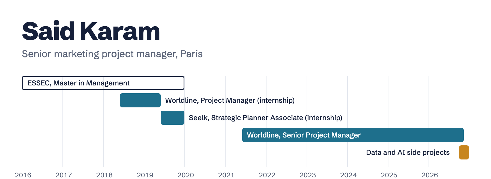

<picture>
  <source media="(max-width: 600px) and (prefers-color-scheme: dark)" srcset="assets/banner-mobile-dark.png">
  <source media="(max-width: 600px)" srcset="assets/banner-mobile-light.png">
  <source media="(prefers-color-scheme: dark)" srcset="assets/banner-dark.png">
  
</picture>

 

I run multichannel marketing projects (digital, print, video) for internal clients at Worldline, in an international setting. I negotiate the agency's annual budget, plan its people and resources, and set up project processes that shorten delivery times and raise quality.

The side projects below are how I learn data and AI hands-on: each one solves a real problem I had.

### Side projects

| Project | What it shows |
|---|---|
| [**Zoé**, AI receptionist for salons](https://github.com/said-karam/zoe-ai-receptionist) | Writing a brief first, then building an assistant that answers WhatsApp and phone calls, books and reminds. EU data by design. |
| [**Visuals**, marketing images at every size](https://github.com/said-karam/marketing-visuals) | My day job as a tool: one campaign message drawn at 15 social, store and icon sizes, in every language, in the browser. |
| [**Luxury and beauty web benchmark**](https://github.com/said-karam/luxury-beauty-web-benchmark) | Competitive analysis from public data: 15 brands' sites measured for speed, accessibility, consent and AI visibility. |
| [**Post Check**, AI review for social media posts](https://github.com/said-karam/post-check) | A live AI tool with real guardrails: a score out of 100 and three fixes per post, with daily quotas and abuse protection. |
| [**Chess review coach**](https://github.com/said-karam/chess-review-coach) | A live product: move-by-move review and a coach that explains each move, with the engine running in the browser. |
| [**Training dashboard**](https://github.com/said-karam/training-dashboard) | Personal data pipeline: Garmin sync, data minimisation, private storage, password-protected site. |
| [**Trio**, language practice](https://github.com/said-karam/trio-language-practice) | Lessons generated with Claude, then checked and repaired by the app before use. |

### Experience

**Worldline**, Senior Project Manager. La Défense, June 2021 to present.
Annual agency budget, multichannel marketing projects for internal clients, project management processes, project reviews and coordination between creative, product and communication teams.

**Seelk**, consultancy for Amazon, Strategic Planner Associate (internship during my studies). Paris, June 2019 to January 2020.
Long-term growth strategy, weekly to quarterly client reporting, market and competitive analysis of Amazon categories.

**Worldline**, Project Manager (internship during my studies). Bezons, June 2018 to June 2019.
KPI tools and reports for the COMEX, company transformation, the annual international seminar.

### Education and languages

ESSEC Business School, Master in Management (Programme Grande Ecole), 2016 to 2020. Core Track Singapore, Chaire Digital Disruption.

French and English fluent, Italian advanced.

### Contact

[saidkaramparis@gmail.com](mailto:saidkaramparis@gmail.com) 
[LinkedIn](https://www.linkedin.com/in/saidkaram7)

<b>Version française</b>

 

Je pilote des projets marketing multicanaux (digital, print, vidéo) pour des clients internes chez Worldline, dans un contexte international. Je négocie le budget annuel de l'agence, j'optimise ses ressources et je mets en place des processus qui raccourcissent les délais et améliorent la qualité.

Les projets ci-dessous sont ma façon d'apprendre la data et l'IA par la pratique : chacun résout un vrai problème que j'avais.

**Projets personnels**

- [Zoé, réceptionniste IA pour salons](https://github.com/said-karam/zoe-ai-receptionist) : un cahier des charges d'abord, puis un assistant qui répond sur WhatsApp et au téléphone, prend les rendez-vous et envoie les rappels. Données hébergées dans l'UE.
- [Visuals, visuels marketing à toutes les tailles](https://github.com/said-karam/marketing-visuals) : mon métier en outil, un message de campagne décliné en 15 formats réseaux sociaux, stores et icônes, dans chaque langue, directement dans le navigateur.
- [Benchmark web luxe et beauté](https://github.com/said-karam/luxury-beauty-web-benchmark) : analyse concurrentielle à partir de données publiques, les sites de 15 marques mesurés sur la vitesse, l'accessibilité, le consentement et la visibilité auprès des IA.
- [Post Check, revue IA de posts réseaux sociaux](https://github.com/said-karam/post-check) : un outil IA en ligne avec de vrais garde-fous, une note sur 100 et trois corrections par post, avec quotas quotidiens et protection contre les abus.
- [Coach d'analyse d'échecs](https://github.com/said-karam/chess-review-coach) : un produit en ligne, analyse coup par coup et coach qui explique chaque coup, moteur exécuté dans le navigateur.
- [Tableau de bord d'entraînement](https://github.com/said-karam/training-dashboard) : synchronisation Garmin, minimisation des données, stockage privé, site protégé par mot de passe.
- [Trio, entraînement aux langues](https://github.com/said-karam/trio-language-practice) : leçons générées avec Claude, puis vérifiées et corrigées par l'application avant usage.

**Expérience**

**Worldline**, chef de projet senior. La Défense, juin 2021 à aujourd'hui.
Budget annuel de l'agence, projets marketing multicanaux pour des clients internes, processus de gestion de projet, revues projet et coordination entre les équipes créatives, produit et communication.

**Seelk**, cabinet de conseil pour Amazon, Strategic Planner Associate (stage pendant mes études). Paris, juin 2019 à janvier 2020.
Stratégie de croissance à long terme, rapports clients hebdomadaires à trimestriels, études de marché et analyse concurrentielle des catégories Amazon.

**Worldline**, chef de projet (stage pendant mes études). Bezons, juin 2018 à juin 2019.
Outils et rapports d'indicateurs clés pour le COMEX, transformation de l'entreprise, séminaire international annuel.

**Formation et langues**

ESSEC Business School, Master in Management (Programme Grande Ecole), 2016 à 2020. Core Track Singapour, Chaire Digital Disruption.

Français et anglais courants, italien avancé.

**Contact** : [saidkaramparis@gmail.com](mailto:saidkaramparis@gmail.com), [LinkedIn](https://www.linkedin.com/in/saidkaram7)

